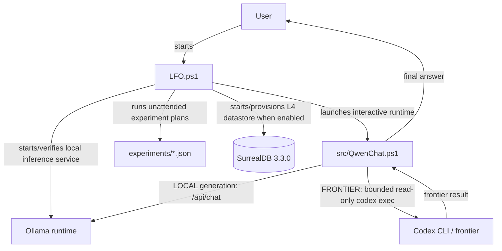
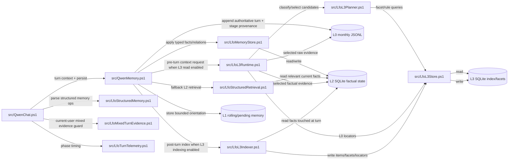
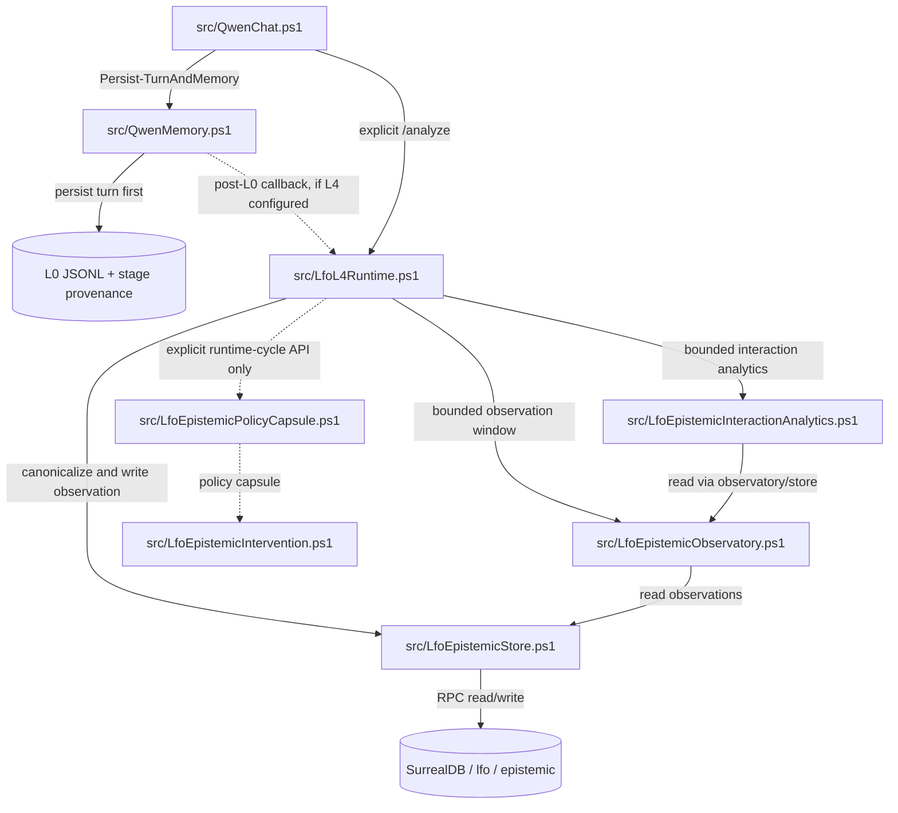

# Architecture

## 1. Purpose

Local Frontier Orchestrator is a research-oriented local-first AI gateway. It separates three concerns that are often collapsed into one model call:

1. **conversation and local execution**;
2. **routing / escalation policy**;
3. **frontier research or stronger reasoning**.

The current reference implementation uses a small Qwen model through Ollama for the local layer and native Codex CLI for frontier escalation.

## 2. Primary Qwen-first flow

```text
user request
    |
    v
hard capability / freshness policy
    |
    +-- forced FRONTIER ------------------------------+
    |                                                 |
    v                                                 |
local Qwen route decision                             |
    |                                                 |
    +-- LOCAL -> answer ------------------------------+
    |
    +-- FRONTIER
           |
           v
     bounded ask_codex
           |
           v
   codex exec (read-only)
           |
           v
  frontier result / web research
           |
           v
 Qwen final synthesis / critique
           |
           v
          user
```

### Why keep Qwen after the frontier call?

Conversation continuity alone does not require rewriting the frontier output, but the research architecture intentionally keeps a local post-processing layer.

The desired behaviour is **creative but anchored**:

- concrete researched facts, numbers, identifiers, dates, dimensions, prices, caveats, and source links should not be silently replaced by model memory;
- Qwen may reorganize and explain the result;
- Qwen may identify a conflict or uncertainty;
- Qwen may add stable background knowledge or interpretation when clearly distinguishable from the researched evidence;
- the local layer may later implement bias-aware critique and metacognitive interventions.

This creates a useful boundary:

```text
frontier evidence -> sticky provenance
local layer       -> interpretation, critique, presentation, policy
```

The distinction is a behavioural target, not a formal guarantee. It must be evaluated empirically over long-term use.

## 3. Routing

The MVP combines two mechanisms.

### Deterministic hard gates

Some task classes should not depend on a small model's confidence:

- explicit requests to browse/search/use frontier;
- current or recent information;
- live state;
- current software versions/releases;
- URLs that need to be fetched;
- exact specifications of named external products.

These rules are intentionally narrow.

### Model routing

When no hard gate fires, Qwen returns one of:

```text
ROUTE: LOCAL
ROUTE: FRONTIER
```

Malformed routing fails closed to LOCAL rather than silently spending frontier resources.

## 4. Frontier transport

The frontier action is a wrapper around native `codex exec`.

Current constraints:

- read-only sandbox;
- no interactive approval;
- web search available to the frontier;
- prompt via UTF-8 stdin;
- bounded prompt size;
- timeout;
- one frontier call per user turn;
- no generic command execution exposed to Qwen.

This is deliberately not a general tool-use framework yet.

## 5. Runtime profiles

The orchestration layer should not hard-code a single machine profile.

Runtime/model profiles own:

- model tag;
- quantization;
- CPU/GPU offload;
- context length;
- thread count;
- model storage;
- accelerator-specific settings.

This supports heterogeneous deployments: a modern GPU host, an older CPU-oriented host, or an edge/SBC accelerator can all present the same orchestration contract.

## 6. Policy and configuration boundary

The Windows reference implementation keeps process-control logic separate from behavioural policy:

```text
src/QwenChat.ps1              orchestration / transport
config/QwenChat.config.psd1  hard gates and generation defaults
policy/orchestrator-system.txt
policy/synthesis-system.txt
policy/frontier-subagent.txt
```

This is intentionally different from host runtime configuration. GPU/CPU placement, context length, thread count, quantization, and model storage remain properties of the selected Ollama runtime/model profile.

A change to language policy or synthesis behaviour should not require editing the Codex process wrapper. Conversely, moving to a weaker or stronger host should not require rewriting routing logic.

Avoid using a single surprising answer as a reason to retune the sampler or routing policy. The system is stochastic; changes should be driven by repeated, categorized failures or explicit experimental conditions.

## 7. Context, memory, provenance and L4

The current v9.6.2 runtime separates complementary roles:

```text
L0  raw conversation evidence / stage provenance
L1  bounded conversational orientation
L2  typed factual state
L3  selective retrieval/index metadata
L4  epistemic observations and bounded analytics
```

`/exit` preserves persistent state. `/clear` starts a new conversation epoch:
active messages and L1 state are cleared while historical JSONL, scoped L2/L3
records and L4 observations remain available as historical evidence.

The model-visible context is bounded. Depending on enabled features it may
combine:

```text
rolling L1 state
+ pending notes
+ selected L0/L2 evidence
+ recent raw turns
+ current request
```

L0 monthly JSONL remains the authority for captured interaction history. L2
owns structured current/historical state. L3 narrows evidence without becoming
authoritative. L4 records derived epistemic observations and never becomes
factual merely because an annotation exists.

v9.6.1 introduced L0 stage-source capture for L4 provenance; v9.6.2 preserves it. Positive conservative
T1 observations are written only after durable L0 persistence. Explicit
`/analyze` performs bounded A1/A2 reads; ordinary turns do not receive
continuous L4 history. P1/P2 response intervention remains OFF.

The PowerShell wrapper, not Qwen, owns persistence, retrieval, provenance,
logging and database access. Qwen receives no filesystem/shell tool.

For the detailed runtime contract see
[MEMORY_AND_LOGGING.md](MEMORY_AND_LOGGING.md),
[L2_FROZEN_BASELINE.md](L2_FROZEN_BASELINE.md),
[L3_FROZEN_BASELINE.md](L3_FROZEN_BASELINE.md) and
[L4_RECORDING_MANUAL_ANALYSIS.md](L4_RECORDING_MANUAL_ANALYSIS.md).

### Generic epistemic mediator research boundary

The generic mediator workstream is documented in
[GENERIC_EPISTEMIC_MEDIATOR.md](GENERIC_EPISTEMIC_MEDIATOR.md). It distinguishes
observable interaction signals from stronger interpretations, measures
phenomenon-specific magnitude against explicit reference/control conditions and
keeps experimental interventions separate from the current default runtime.

## 8. Canonical runtime module topology

This section is the canonical module-to-module topology for architecture diagrams.
It documents only relationships that are present in the current source or explicitly
enabled by configuration. Optional and experimental paths are labelled as such.

### 8.1 Launcher and conversational runtime



The launcher owns process/service orchestration, runtime profile selection, process
priority and unattended experiment envelopes. `QwenChat.ps1` owns the interactive
turn, LOCAL/FRONTIER routing, local generation, optional frontier handoff, synthesis
and the final call into persistence.

### 8.2 Memory and retrieval dataflow



The important ownership boundaries are:

- `QwenChat.ps1` loads the memory/retrieval modules but does not give Qwen direct
  filesystem or database access.
- `QwenMemory.ps1` is the orchestration boundary for per-turn context assembly and
  persistence.
- `LfoMemoryStore.ps1` owns the SQLite interop and L2 factual-store mutations.
- `LfoStructuredRetrieval.ps1` provides the bounded L2 read path.
- `LfoL3Runtime.ps1` is the L3 read-side integration point; it uses the planner/store
  and can retrieve selected evidence from both L0 and L2.
- `LfoL3Indexer.ps1` is the L3 write-side post-turn indexer; it derives index metadata
  from the persisted turn and L2 facts.
- L3 narrows/selects evidence. It is not an authoritative factual store.

### 8.3 L4 recording and manual analysis

The ordinary chat path writes L0 first. Only after durable L0 persistence may the
configured L4 callback record a conservative observation.



Runtime semantics:

- **Ordinary turns:** L0 persistence may trigger the conservative post-L0 L4 recorder
  when L4 is configured.
- **`/analyze`:** explicit bounded A1/A2 read-only analysis of already recorded L4
  observations.
- **P1/P2:** loaded by `LfoL4Runtime.ps1`, but response intervention is **OFF in the
  accepted ordinary chat runtime**. The P1/P2 path is available only through explicit
  runtime-cycle / experimental use.
- L4 observations remain derived, provenance-linked research objects. They do not
  become L2 facts or hidden user attributes.

### 8.4 Offline and auxiliary epistemic components

The following modules are part of the repository but are **not implicit edges in the
ordinary chat runtime**:

```text
src/LfoEpistemicDetectorBaseline.ps1   deterministic offline detector/benchmark
src/LfoEpistemicDetectorModel.ps1      model-based offline detector/benchmark
src/LfoEpistemicAnnotationWorkflow.ps1 explicit annotation import/workflow
src/LfoEpistemicPilotAnalytics.ps1     read-only pilot analytics
```

They should therefore appear in architecture diagrams as auxiliary/offline epistemic
capabilities rather than as automatic steps between every user prompt and response.

### 8.5 Edge list for tooling and diagram generators

For tools that infer architecture from prose, the current explicit edges are:

```text
User -> LFO.ps1
LFO.ps1 -> src/QwenChat.ps1
LFO.ps1 -> Ollama runtime
LFO.ps1 -> experiments/*
LFO.ps1 -> SurrealDB

src/QwenChat.ps1 -> Ollama runtime
src/QwenChat.ps1 -> Codex CLI
Codex CLI -> src/QwenChat.ps1

src/QwenChat.ps1 -> src/QwenMemory.ps1
src/QwenChat.ps1 -> src/LfoStructuredMemory.ps1
src/QwenChat.ps1 -> src/LfoMixedTurnEvidence.ps1
src/QwenChat.ps1 -> src/LfoTurnTelemetry.ps1
src/QwenChat.ps1 -> src/LfoL4Runtime.ps1

src/QwenMemory.ps1 -> L0 JSONL
src/QwenMemory.ps1 -> L1 memory
src/QwenMemory.ps1 -> src/LfoMemoryStore.ps1
src/LfoMemoryStore.ps1 -> L2 SQLite
src/QwenMemory.ps1 -> src/LfoStructuredRetrieval.ps1
src/LfoStructuredRetrieval.ps1 -> L2 SQLite

src/QwenMemory.ps1 -> src/LfoL3Runtime.ps1
src/LfoL3Runtime.ps1 -> src/LfoL3Planner.ps1
src/LfoL3Runtime.ps1 -> src/LfoL3Store.ps1
src/LfoL3Runtime.ps1 -> L0 JSONL
src/LfoL3Runtime.ps1 -> L2 SQLite
src/QwenMemory.ps1 -> src/LfoL3Indexer.ps1
src/LfoL3Indexer.ps1 -> src/LfoL3Store.ps1
src/LfoL3Indexer.ps1 -> L2 SQLite
src/LfoL3Store.ps1 -> L3 SQLite

src/QwenMemory.ps1 -> src/LfoL4Runtime.ps1   [post-L0 callback, optional]
src/LfoL4Runtime.ps1 -> src/LfoEpistemicStore.ps1
src/LfoEpistemicStore.ps1 -> SurrealDB
src/LfoL4Runtime.ps1 -> src/LfoEpistemicObservatory.ps1   [/analyze]
src/LfoL4Runtime.ps1 -> src/LfoEpistemicInteractionAnalytics.ps1   [/analyze]
src/LfoEpistemicInteractionAnalytics.ps1 -> src/LfoEpistemicObservatory.ps1

src/LfoL4Runtime.ps1 -> src/LfoEpistemicPolicyCapsule.ps1   [explicit/experimental]
src/LfoEpistemicPolicyCapsule.ps1 -> src/LfoEpistemicIntervention.ps1   [explicit/experimental]
```

This list is descriptive documentation, not a separate executable configuration.
Source code remains authoritative if documentation and implementation diverge.

## 9. Synthesis policy

The current prototype uses non-zero sampling during frontier synthesis because the local layer is intentionally allowed to act as an editor and critic rather than a byte-for-byte pipe.

The desired property is not maximal copying. It is **semantic fidelity for sourced facts plus useful transformation for presentation and reasoning**.

Long-term evaluation should therefore track at least:

- factual preservation;
- unsupported additions;
- loss of caveats;
- source-link preservation;
- useful restructuring;
- independent critique;
- latency and token cost.

## 10. Security boundary

The local model should not be trusted as a shell command generator.

A deterministic wrapper owns:

- the executable;
- fixed Codex arguments;
- sandbox mode;
- web policy;
- timeout;
- environment filtering;
- prompt transport.

Future write-capable modes should be separate capabilities rather than a silent expansion of `ask_codex`.

## 11. Alternative Codex-first branch

Experiments with Codex Router demonstrate a complementary architecture:

```text
Codex interface -> Codex Router -> local model
```

This can expose the local model through the Codex agent interface. It is technically functional, but small local models can be burdened by a large agent/tool context and require further tuning.

The Qwen-first and Codex-first paths are treated as separate experimental branches rather than forced into one runtime dependency graph.
